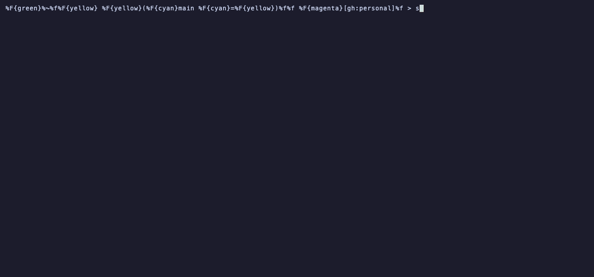

<h1 align="center">herdr-mods</h1>

<p align="center">
  <b>Claude Code mods, running natively in <a href="https://herdr.dev">herdr</a> panes beside <a href="https://opencode.ai">opencode</a>.</b><br>
  Same mod. Same hooks. Same <code>Pane</code> view. No changes.
</p>

<p align="center"></p>

<sub>The orch-graph mod, from the [orch-skill](https://github.com/barnuri/orch-skill) repo (the orca skill),
drawn in a herdr pane. The left side is a made-up orch run (`demo/orch-graph/mock/`). The right pane is
the mod's own `view.ts`. No real run is read. Re-record it with
`ORCH_SKILL_DIR=/path/to/orch-skill vhs demo/orch-graph.tape`, or use the
[`herdr-mods-demo` skill](skills/herdr-mods-demo/SKILL.md).</sub>

<p align="center"></p>

<sub>The summarize mod from [harness-status-line](https://github.com/barnuri/harness-status-line), run
unchanged. The demo runs the Claude Code mod on the left. The pane on the right is that same mod's
`Pane` view, drawn by herdr-mods. The turns are made up; no real session data is shown. Re-record it with
`vhs demo/demo.tape`, or use the [`herdr-mods-demo` skill](skills/herdr-mods-demo/SKILL.md).</sub>


## Why

A Claude Code mod is a small TypeScript plugin: `on('turn.complete', ...)` hooks, `atom` state, and a
`Pane` view with buttons. herdr-mods **is the same API on opencode**, so a mod you wrote for Claude
Code works here with no port:

| | Claude Code | herdr-mods |
|---|---|---|
| Hooks (`session.start`, `turn.start`, `tool.call`, `turn.complete`, `command.run`) | yes | **yes, same names and payloads** |
| `$` engine (`$.fs`, `$.process`, `$.clock`, `$.ui`, `$.command`) | yes | **yes** |
| `atom`, `read`, `update` from `claude-code` | yes | **yes** |
| `Pane` view (`Box`, `Text`, `Button`, `Link`, hotkeys) | docked pane | **a real herdr pane** |
| Your mod's source | `hooks/register.tsx` | **the same file** |

You also get what a docked pane can't do: it runs in its own terminal process, so it can draw
anything a terminal can, keep running while you work, and sit on the right of a wide screen or below
a narrow one.

## Features

- **Runs Claude Code mods unchanged.** Drop the mod folder in `~/.config/herdr-mods/mods`. See
  [Claude Code mods](#claude-code-mods).
- **Tabs for many mods.** One panel per agent pane holds a tab per active mod, named after the mod,
  as in Claude Code. Click a tab, or press Tab, to switch. A mod is active at most once: running its
  command again (for example for another session) replaces its tab. An automatic open adds a tab
  without switching to it; a command you run yourself switches to its tab. With one mod, no tab row shows.
- **Sub-agents roll up into the main session.** Sub-agent turns feed the main session's mod state.
  They never start a session or a panel of their own.
- **Close it with `x`.** A button in the top right corner, like Claude Code. `Ctrl+C` works too.
- **Named after the mod.** Each tab shows its mod's name. The pane title reads `<mod name> mod` for the selected tab.
- **Smart placement.** At least 140 columns wide, the panel sits on the right; narrower, below. It moves
  when the screen changes size, for example when you open the session from a phone or back on a PC.
  Claude Code mod panes opened through the `open` CLI do not move yet.
- **Resizable.** Drag the border between the panel and opencode, or press the `-` and `+` buttons in the
  panel's top right corner (or the `-` and `+` keys) to shrink or grow it by 5%. A mod that uses `+` or `-`
  for its own hotkey keeps them. The size you set stays until the panel moves to another side.
- **Native mods are easy to write.** `bun bin/new.ts <name>` scaffolds one. No config needed.
- **herdr-owned panes.** A panel opens by itself once. After you close it (the `x` closes every tab),
  it stays closed until you run a mod's command.

## Install

herdr-mods is a herdr plugin (`barnuri.mods`). Install it from the herdr marketplace (the repo
carries the `herdr-plugin` topic):

```bash
herdr plugin install barnuri/herdr-mods
```

Or link a local checkout for development:

```bash
git clone https://github.com/barnuri/herdr-mods
herdr plugin link ./herdr-mods
```

It needs [Bun](https://bun.sh). `bin/bun.sh` finds Bun even when herdr's `PATH` doesn't include it.

### opencode

Add the plugin folder to `~/.config/opencode/cli.json`:

```json
{ "plugins": ["/absolute/path/to/herdr-mods"] }
```

Optional settings go in the object form: `mods` lists extra mod paths, and `modOptions` sets options
per mod id.

```json
{
  "plugins": [
    {
      "package": "/absolute/path/to/herdr-mods",
      "options": {
        "mods": ["/somewhere/else/mod.ts"],
        "modOptions": { "claude-summarize": { "showFilePaths": true } }
      }
    }
  ]
}
```

Start opencode inside a herdr pane. Outside herdr, the mods load but open no panes.

### Claude Code

A Claude Code mod can open its pane in herdr instead of the Claude pane. It writes its state to
`~/.cache/herdr-mods/<mod id>/<key>.json`, then runs the `open` CLI (see
[Open a pane from any harness](#open-a-pane-from-any-harness)). The
[summarize](https://github.com/barnuri/harness-status-line) and
[orch-graph](https://github.com/barnuri/orch-skill) Claude mods do this. Each finds herdr-mods
through `herdr plugin list --json`.

## The mods folder

Every sub-folder of `~/.config/herdr-mods/mods` (or `$HERDR_MODS_DIR`) is a mod:

- a folder with `mod.ts` is a herdr mod;
- a folder with `.claude-plugin/plugin.json` and `hooks/hooks.json` is a Claude Code mod.

Register a mod by creating its folder there, or by symlinking an existing one:

```bash
ln -s ~/code/my-claude-mod ~/.config/herdr-mods/mods/my-claude-mod
```

Restart opencode to load new mods.

## Write a mod

Create a working mod in the mods folder:

```bash
bun bin/new.ts hello      # creates ~/.config/herdr-mods/mods/hello/{mod.ts,view.ts}
```

Restart opencode and run `/hello`. A mod is two modules.

`mod.ts` runs inside opencode. Its default export is a `HerdrMod` (`src/modApi.ts`):

```ts
import { join } from 'node:path';

export default {
  id: 'hello',
  pane: { module: join(import.meta.dir, 'view.ts') },
  command: {
    name: 'hello',
    description: 'Open the hello pane',
    run: async (args, api) => {
      await api.publish('main', { greeting: args || 'hello' });
      await api.openPane('main', { isForced: true });
    },
  },
  setup(api) {
    api.onMessage('main', (message) => api.toast(`pane says ${JSON.stringify(message)}`));
  },
};
```

| `api` member | What it does |
|---|---|
| `opencode` | opencode's TUI plugin context. Use it for session events (`data.on(...)`) and messages |
| `publish(key, state)` | Saves JSON state for the pane named `key` |
| `openPane(key, { isForced? })` | Opens that pane beside the agent. It opens once by itself; `isForced` reopens a closed pane |
| `isPaneOpen(key)` | Whether that pane is open now |
| `onMessage(key, handler)` | Receives what the pane sends with `ui.send` |
| `toast`, `logError`, `directory`, `currentSessionId`, `options` | The usual helpers |

`command` (or `commands()`, for a list) becomes a slash command. A string it returns shows as a
toast. `setup` may be async; the host waits for it before it registers commands.

`view.ts` runs in the herdr pane. Its default export draws the last published state:

```ts
const node = (type, props, ...children) => ({ type, props, children });

export default function view(state, ui) {
  const { Box, Text, Button } = ui.elements;
  const [count, setCount] = ui.local('count', 0);
  return node(Box, { flexDirection: 'column' },
    node(Text, { bold: true, color: '#D77757' }, state?.greeting ?? 'waiting'),
    node(Button, { hotkey: 'c', onPress: () => { setCount(count + 1); ui.send({ clicked: count + 1 }); } },
      node(Text, { underline: true }, `clicked ${count}`)),
  );
}
```

A view can also be classic JSX: `.tsx` files in the pane process compile with an `h` factory.

| `ui` member | What it does |
|---|---|
| `elements` | `Box`, `Text`, `Button`, `Link` |
| `columns`, `rows` | The size of the view: the pane, less the tab row |
| `local(name, initial)` | Pane-local state: the value and a setter that redraws |
| `send(message)` | Sends JSON to the mod inside opencode |
| `open(target)`, `notice(message)`, `redraw()`, `close()` | Open a URL or file, show a notice line, redraw, close |
| `takeover(argv)` | Runs `argv` in the pane's own terminal until it exits (for example `terminal-browser open <page>`), then redraws. Resolves to the exit code, or -1 |

### Elements

| Element | Props |
|---|---|
| `Box` | `flexDirection` (`row` or `column`), `columnGap`, `flexWrap`, `paddingLeft`, `paddingRight`, `marginTop`, `minHeight`, `flexGrow` |
| `Text` | `color` (hex or name), `bold`, `dimColor`, `underline`, `wrap` (`wrap`, else truncate) |
| `Button` | `onPress`, `hotkey` (a click or the key presses it) |
| `Link` | `href` (opens with the OS opener) |

## Claude Code mods

herdr-mods runs an unchanged Claude Code mod inside opencode:

1. The loader compiles the mod's `.ts` and `.tsx` files to plain JS in
   `~/.cache/herdr-mods/claude-build/`. Classic JSX compiles to a private factory, and
   `import ... from 'claude-code'` points at herdr-mods' own `atom` / `read` / `update`.
2. The runtime calls each module's `register(on, options)`. The options are the mod's
   `userConfig` defaults, merged with `modOptions["claude-<name>"]`.
3. opencode events become the mod's events, and `$` is a herdr-mods engine.
4. `$.ui.open` renders the mod's `Pane` inside opencode. The frame goes to a herdr pane, and
   button presses and the pane size come back to the mod.

The mod id is `claude-<name>`, where `<name>` comes from its `plugin.json`.

| Claude Code mod API | Support |
|---|---|
| `session.start` | Once, when opencode starts |
| `turn.start` | When a turn starts, with the prompt text |
| `skill.prompt` | For each skill attached to the prompt |
| `tool.call` | Each finished tool call, after the turn ends. Tool names are Claude's (`Bash`, `Edit`, `Write`, `Skill`, `Agent`, ...), and `next(e)` returns the real result. A mod can observe a call, but cannot deny or change it |
| `turn.complete` | With `answer`, `durationMs`, `reason` and `usage.output_tokens` |
| `command.run` | From the slash commands the mod registers with `$.command.register`. The first line of the returned `text` shows as a toast |
| `ui.render` (`Pane`) | Renders into a herdr pane, with `bodyColumns` and `scroll.bodyRows` from the pane size |
| `ui.close` | When the person closes the pane |
| `ui.render` (`AbovePrompt`, bands) | Not supported (opencode has no slot for it here) |
| `$.ui.open`, `$.ui.resolve`, `$.ui.toast`, `$.ui.log` | Supported |
| `$.command.register` | Supported |
| `$.fs.exists`, `read`, `write`, `list` | Supported |
| `$.process.run` (`cwd`, `env`, `timeoutMs`) | Supported |
| `$.clock.now`, `$.clock.every` | Supported |
| `$.env.get` | Supported. It hides `HERDR_ENV` and `HERDR_PANE_ID`, so a mod with its own herdr path uses its Claude pane, which is the herdr pane here |
| `$.session.id`, `$.session.cwd`, `$.plugin.root` | Supported |
| `atom`, `read`, `update` from `claude-code` | Supported, per mod, in memory |
| `claude-code/testing` | Not supported (test Claude mods with Claude's own runner) |

## Open a pane from any harness

`bin/open.ts` opens a mod pane beside any herdr pane. A harness without the opencode host can use
it, a Claude Code mod for example:

```bash
# write ~/.cache/herdr-mods/<mod id>/<key>.json first
sh <herdr-mods>/bin/bun.sh <herdr-mods>/bin/open.ts \
  --mod-id summarize --view /path/to/view.ts --key <session id> --beside "$HERDR_PANE_ID" [--force]
# prints {"open": true}
```

The mod becomes a tab of the agent pane's mod panel. Each agent pane keeps one panel, and each mod one tab:
the panel opens once by itself, and stays closed after the person closes it until `--force`.

## Mods

- **summarize** ([harness-status-line](https://github.com/barnuri/harness-status-line)): a recap of
  every turn, with session repos, PRs, commits, skills and the session Q&A. It comes as a herdr mod
  (`opencode-summarize/`) and as a Claude Code mod (`claude-mods/summarize`).
- **orch-graph** ([orch-skill](https://github.com/barnuri/orch-skill)): the live DAG of the active
  orch run, with "open in dashboard" and "retry failed nodes".

### orch-graph demo (mock data)

The top of this README shows the orch-graph demo. To see the pane without recording, run `ORCH_SKILL_DIR=/path/to/orch-skill sh demo/orch-graph/stage.sh`.
`ORCH_SKILL_DIR` is the orch-skill checkout that holds `mods/orch-graph`. The demo writes only under a
temp `$HOME`.

## Files

| Path | What it is |
|---|---|
| `herdr-plugin.toml` | The herdr plugin manifest: the `mod` pane entrypoint and the build step |
| `tui.ts` | The opencode TUI plugin entry |
| `src/modApi.ts` | The mod contract |
| `src/opencode/opencodeHost.ts` | Loads mods, runs `setup`, registers commands, opens panes |
| `src/mods/modFolder.ts` | The mods folder |
| `src/claude/` | Claude Code mod support: the loader, the `claude-code` shim, the runtime, and the frame bridge |
| `src/herdr/` | herdr plugin pane calls, placement, and the pane lifecycle |
| `src/state/` | State files, pane messages, and the error log (`~/.cache/herdr-mods/errors.jsonl`) |
| `src/pane/paneRunner.ts`, `bin/pane.ts` | The pane process: draws the tab row and the selected tab's view, routes clicks and keys |
| `src/render/termRenderer.ts` | Draws a view tree as terminal lines with click regions |
| `bin/new.ts`, `bin/open.ts`, `bin/bun.sh` | Scaffold a mod, open a pane from any harness, find Bun |

## Develop

```sh
bun test
bunx tsc --noEmit -p .
```

## License

MIT
